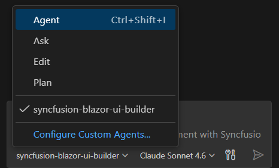

# Syncfusion® Agentic Blazor UI Builder Skill for AI Assistants

**Syncfusion® Agentic Blazor UI Builder** is an AI-powered skill and companion agent that turns natural-language UI requirements into Blazor components built with [Syncfusion® Blazor components](https://www.syncfusion.com/blazor-components).

The skill runs inside your AI-powered IDE, so you can build dashboards and other user interfaces without leaving your development workflow. It combines component knowledge, theming guidance, and accessibility and security checks to produce code that is ready for your review.

## Prerequisites

Before installing Blazor UI Builder, ensure the following:

| Requirement | Description |
|-------------|-------------|
| **Blazor Project** | Active Blazor WebAssembly or Blazor Server project (.NET 8+). The skill can also offer to create a project if none is found. |
| **Microsoft .NET SDK 8.0 or later** | .NET CLI tools installed. Run `dotnet --version` to verify. |
| **Node.js version 18 or later** | npm package manager installed |
| **Git** | Required by APM, which downloads packages from Git repositories |
| **Agent Package Manager (APM)** | APM installed. See the [APM installation guide](https://microsoft.github.io/apm/getting-started/installation/). |
| **Syncfusion® License** | [Commercial](https://www.syncfusion.com/sales/pricing?category=ui-components), [Free Community](https://www.syncfusion.com/products/communitylicense), or [Free Trial](https://www.syncfusion.com/account/manage-trials/start-trials) |
| **Supported AI Agent / IDE** | An AI agent or IDE that supports agent skills, such as VS Code with GitHub Copilot, Cursor, Claude Code, Codex, or Syncfusion® Code Studio |

## Key Benefits

### **AI-Driven UI Generation**
- Converts prompts into complete Blazor components, not just snippets.
- Selects appropriate Syncfusion® components and features, and asks you to confirm the selection.
- Produces structured, maintainable code.

### **Component Usage and API Accuracy**
- Uses [Syncfusion® Blazor component](https://blazor.syncfusion.com/documentation/introduction) APIs, backed by the [Blazor component skills](https://blazor.syncfusion.com/documentation/skills) that are installed with it.
- Identifies the required Syncfusion® NuGet packages and prepares the install commands.

### **Accessibility and Responsiveness**
- Validates generated code against WCAG 2.1 AA guidelines.
- Uses semantic HTML with ARIA attributes.
- Uses mobile-first responsive layouts.

### **Design-System Integration**
- Works with Tailwind, Bootstrap, Material, or a custom (greenfield) design system.
- Uses the Syncfusion® theme that matches your choice, with Fluent 2 Light as the default.

## Installation

### Where to run the commands

Run all `apm` commands in a terminal from the root folder of your Blazor project, which is the folder that contains your `.csproj` or `.sln` file. APM writes its manifest and the AI assistant files into the current folder, so installing from another location places them outside your project.

### Verify APM installation

Run the following command to confirm that APM is installed:

```bash
apm --version
```

If the terminal reports `apm: command not found`, open a new terminal window. If the error remains, follow the [APM installation guide](https://microsoft.github.io/apm/getting-started/installation/#verify-the-install).

### Install the Syncfusion® Agentic Blazor UI Builder package using APM

Run the command for the AI agent you use. The `-t` option sets the APM target, which decides where APM writes the files.




apm install syncfusion/blazor-ui-builder -t copilot





apm install syncfusion/blazor-ui-builder -t cursor





apm install syncfusion/blazor-ui-builder -t codex





apm install syncfusion/blazor-ui-builder -t claude




> For Syncfusion® Code Studio, use the Copilot command.

### What the installation adds

APM installs the UI Builder package together with the Blazor component skills it depends on. In your project root, you will see:

| Item | Description |
|------|-------------|
| `apm.yml` | APM manifest that lists the installed package |
| `apm.lock.yaml` | Lockfile that records the exact version installed |
| `apm_modules/` | Downloaded package sources |
| `.agents/skills/` | Skill files for the Copilot, Cursor, and Codex targets |
| `.github/agents/` | Agent configuration for the Copilot target, including `syncfusion-blazor-ui-builder` |
| `.claude/` | Skill and agent files for the Claude target |
| `.cursor/` | Agent files for the Cursor target |
| `.codex/` | Agent files for the Codex target |

Each target writes only to its own folders. For example, the Copilot target creates `.agents/skills/` and `.github/agents/`. See the APM [targets matrix](https://microsoft.github.io/apm/reference/targets-matrix/) for the full list of deployment locations.

### Verify the installation

1. Confirm that the folders for your target exist in the project root. For Copilot, check `.agents/skills/` and `.github/agents/`.
2. Run `apm deps list` to list the installed packages. `syncfusion/blazor-ui-builder` should appear in the output.
3. Run `apm targets` to see which AI agents APM detects in the project.
4. Open your IDE and check that `syncfusion-blazor-ui-builder` appears in the **Agent dropdown** of the chat panel. Restart the IDE if it does not appear.

## How the Syncfusion® Agentic Blazor UI Builder Skill Works

The skill follows an 8-stage workflow:

1. **Intent Analysis**: Parses your prompt to identify component types and the high-level layout.
2. **Project Detection**: Detects the project framework, Blazor project type, and existing CSS framework, and asks you to confirm the settings. If no project exists, it offers to create one.
3. **Layout Analysis and Component Mapping**: Maps your intent to Syncfusion® components and asks you to confirm the selection.
4. **Theming and Design System**: Loads the theming guidelines and confirms your design choices:
   - CSS framework (Tailwind, Bootstrap, Material, or Greenfield for a custom design system)
   - Syncfusion® theme (Fluent 2, Tailwind3, Bootstrap5, or Material3)
   - Light or dark mode
   - Core design basics such as colors, spacing, typography, and responsiveness
5. **Code Generation**: Produces Blazor `.razor` components and styling.
6. **Validation**: Checks the generated code for accessibility, security, performance, and responsiveness, and asks you to confirm the result.
7. **Dependencies**: Identifies the required NuGet packages and prepares `dotnet add package` commands. Package installation is optional and requires your confirmation.
8. **Code Insertion**: Creates files or patches existing files to match your project structure.

> The assistant completes most stages automatically and asks for your confirmation at the decision points.

### Default theme

The UI Builder uses the **Fluent 2 Light** theme unless you choose another one. The theme comes from the [Syncfusion.Blazor.Themes](https://www.nuget.org/packages/Syncfusion.Blazor.Themes) NuGet package, which the skill adds when needed. You can switch to Fluent 2 Dark, Bootstrap5, Material3, or Tailwind3 when the skill asks you to confirm the design choices, or by naming the theme in your prompt. For more information, see [Themes in Blazor](https://blazor.syncfusion.com/documentation/appearance/themes).

## Generate UIs using the Agentic UI Builder

To start using the skill:

1. Open your Blazor project in a supported IDE.
2. In the chat panel, select the `syncfusion-blazor-ui-builder` agent from the **Agent dropdown**.
  
3. Describe your UI requirements and answer the confirmation questions as the workflow runs.

Example prompts:



Create a login page with the Tailwind 3 theme using a centered card layout containing email and password input fields with validation. Include a "Remember Me" checkbox, a forgot password link, and a primary login button. Add a secondary "Create Account" button below. Ensure the layout is responsive and works on mobile, tablet, and desktop.


Create a CMS Admin Dashboard UI featuring a collapsible sidebar with navigation items for Dashboard, Content, Users, Analytics, and Settings. Add a top header (AppBar) showing the title “CMS Admin Dashboard” on the left and a user name with profile icon on the right. The main content area should include three compact summary cards in a single row displaying Total Content, Total Users, and Active Sessions. Each card shows a label, a relevant icon, a prominent count value, and the percentage change from last month. Below the cards, add a “Content Management” section with a filterable data grid containing columns for Title, Author, Status, Date, and Actions (with edit and delete buttons). Finally, add two charts side by side: a bar chart titled “Content Over Time” and a donut chart titled “Content by Category”. Use realistic sample data for both the grid (10 to 12 rows) and the charts.



Generated code uses semantic HTML, responsive layouts, and typed C# models. The validation stage checks it for accessibility and common security issues, such as unencoded content and hardcoded secrets. You still need to review the result before production, as described in the next section.

## Best Practices

Follow these guidelines to get the best results:

- **Stay consistent**: Maintain consistent file organization, naming conventions, and coding standards throughout your project.
- **Use advanced AI models**: Use **Claude Sonnet 4.6 or higher** capability models for better code quality and more accurate implementations.
- **Review everything before production**: Replace placeholder images or icons (for example, from emoji sets) with your brand assets. Validate the logic, security, and compatibility with your existing code before deployment.

## Troubleshooting

- **APM installation failure**: See the APM [installation troubleshooting guide](https://microsoft.github.io/apm/getting-started/installation/#if-the-install-fails). If `apm install` reports that it cannot detect a target, run the command again with the `-t` option as shown in the Installation section.

- **Files are not created in the project**: You probably ran `apm install` outside the Blazor project root. Change to the folder that contains your `.csproj` or `.sln` file and run the command again.

- **Agent does not appear in the Agent dropdown**: Check that `.github/agents/` (Copilot) or the folder for your target exists in the project root, and that you opened that same folder in the IDE. Restart the IDE or start a new chat session, then select `syncfusion-blazor-ui-builder`. If you installed for a different target than the one your IDE uses, run the install command again for the correct target.

- **Skills not loading**: Check that `.agents/skills/` exists (or `.claude/` for the Claude target) and that `apm deps list` shows the package. Confirm that you selected the `syncfusion-blazor-ui-builder` agent. For skill usage details, see [Blazor Agent Skills](https://blazor.syncfusion.com/documentation/skills).

- **Theme is not applied or looks different from expected**: The default theme is Fluent 2 Light. Name the theme in your prompt or choose it when the skill asks for design decisions. Confirm that the `Syncfusion.Blazor.Themes` NuGet package is installed and that the theme stylesheet reference was added to your project. See [Themes in Blazor](https://blazor.syncfusion.com/documentation/appearance/themes).

- **Package or build errors after generation**: Confirm that all `Syncfusion.Blazor.*` packages in the project use the same version, and run `dotnet restore`. See [Install Syncfusion® Blazor packages](https://blazor.syncfusion.com/documentation/nuget-packages).

- **Component not rendering**: Retry generation and name the component in your prompt. Ensure the required Syncfusion® packages, themes, and scripts are configured in your project.

- **Syncfusion® license banner appears**: Register your license key in the application. See [Syncfusion® license key registration](https://blazor.syncfusion.com/documentation/getting-started/license-key/how-to-register-in-an-application).

## FAQ

**Which agents and IDEs are supported?**
The APM targets for this package are Copilot, Cursor, Codex, and Claude. Any other agent that reads skill files can use the installed files, and Syncfusion® Code Studio uses the Copilot target. See the [Agent Skills standard](https://agentskills.io/home).

**Are skills loaded automatically?**
The `syncfusion-blazor-ui-builder` agent uses the skill files installed in your project. Select the agent from the Agent dropdown to start the workflow.

**Can I customize the generated styles?**
Yes. You can choose Tailwind, Bootstrap, Material, or a custom design system, and pick a Syncfusion® theme during the theming stage. The generated code is regular Blazor markup and CSS that you can edit afterward.

**Does it modify files automatically?**
The skill asks for confirmation at its decision points, including component selection, design choices, and validation results. Installing NuGet packages is optional and also needs your confirmation. Depending on your agent's permission settings, the agent may also ask before it runs commands or writes files.

**Should I commit the installed files?**
`apm.yml` and `apm.lock.yaml` record the installed version, so committing them lets teammates run `apm install` to get the same setup. See the [APM documentation](https://microsoft.github.io/apm/quickstart/) for details.

**How do I update or reinstall the UI Builder?**
Run the same `apm install` command again from the project root. To refresh the installed packages to the latest version, see [apm update](https://microsoft.github.io/apm/reference/cli/update/).

## See also

- [Blazor Skills](https://blazor.syncfusion.com/documentation/skills)
- [Syncfusion® Blazor MCP Server](https://blazor.syncfusion.com/documentation/mcp-server/overview)
- [Blazor UI Builder on GitHub](https://github.com/syncfusion/blazor-ui-builder)
- [Syncfusion® Blazor components](https://www.syncfusion.com/blazor-components)
- [Agent Skills standard](https://agentskills.io/home)
- [Agent Package Manager](https://microsoft.github.io/apm/quickstart/)
