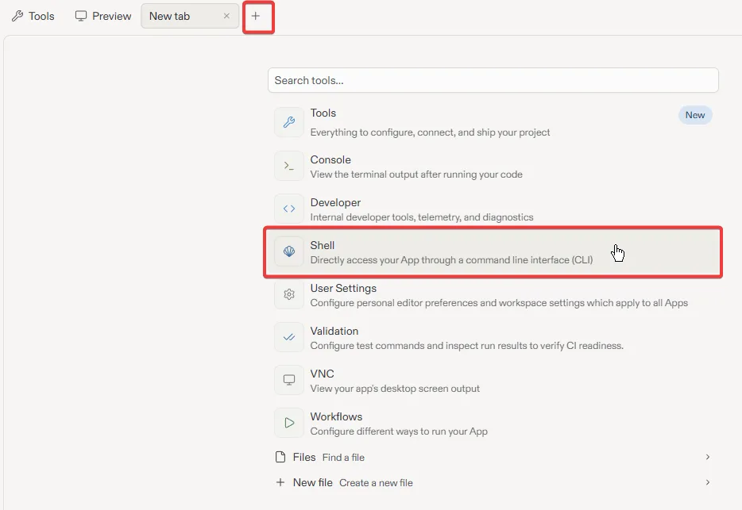
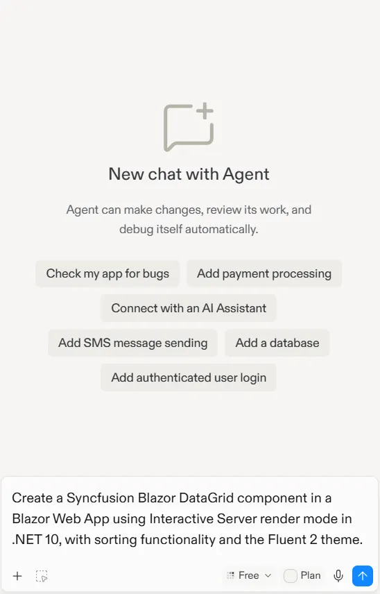
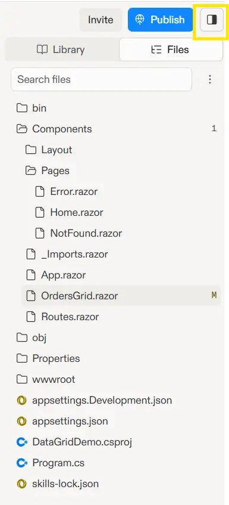
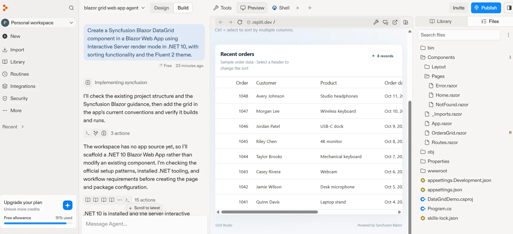
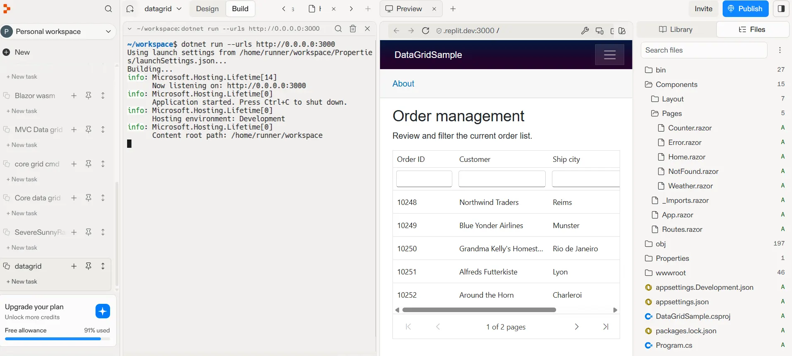

# Getting Started with Blazor DataGrid in Replit

This guide shows two ways to create a [Blazor DataGrid](https://www.syncfusion.com/blazor-components/blazor-datagrid) application in [Replit](https://replit.com):

* **Replit Agent:** Import the Blazor DataGrid skill and ask Agent to build the application from a prompt.
* **Shell:** Create and configure the Blazor application manually with .NET CLI commands and code.

Both approaches create a Blazor Web App with Interactive Server rendering and DataGrid component.

## What is Replit?

[Replit](https://replit.com) is a browser based, AI powered development environment (agentic UI builder) that lets you write, run, and deploy applications entirely in the cloud. It requires no local setup and is well suited for users who are new to software development, or who want to prototype and iterate quickly without configuring local development tools.

## Prerequisites

Before you begin, ensure you have:

* A free or paid [Replit account](https://replit.com).
* A Replit environment with the .NET SDK.
* A valid [Syncfusion license key](https://blazor.syncfusion.com/documentation/getting-started/license-key/overview), either a trial or a commercial key.

## Create an Empty project in Replit

1. Sign in to [Replit](https://replit.com).
2. Click **New** and Select **Empty project**.  

3. Replit creates an empty project with a default generated name.
4. To rename the project, click the project name dropdown located at the top of the Replit workspace, select **Edit project details**, and enter a name such as `datagrid-app`.  

## Create a Blazor DataGrid Application in Replit

This section explains how to add a simple Blazor DataGrid application to the current Replit project and integrate the Blazor DataGrid component with the minimum required setup using either of the following approaches.

Before proceeding, click the **+** icon in the tab bar and select **Shell** from the new tab. The Shell is required for both the Agent Skills and dotnet CLI approaches described in the following sections.





## Install the Syncfusion Blazor DataGrid skills

In the Shell tab, run the following command to install the Blazor DataGrid [skills](https://github.com/syncfusion/blazor-ui-components-skills/tree/master/skills/syncfusion-blazor-datagrid):




npx skills add syncfusion/blazor-ui-components-skills --skill syncfusion-blazor-datagrid




## Prompt Replit Agent to create the application

Once skills are installed, the Replit Agent can generate DataGrid component code automatically. Open the Replit Agent panel and enter a prompt such as:

Example prompt:




Create a Syncfusion Blazor DataGrid component in a Blazor Web App using Interactive Server render mode in .NET10, with sorting functionality and the Fluent 2 theme.




The agent will:
- Create a Blazor application with .NET10.
- Install the required Syncfusion packages
- Import the theme CSS in the correct file
- Generate the complete DataGrid component implementation with requested features
- Create sample data and configuration based on your requirements

**Review and Modify:** Review the generated code by opening the **Library** panel on the right side. Click the **Files** tab to view all project files. Then, click on files like `Components/Pages/*.razor`, `App.razor` to view and edit the generated code if needed. You can also press **Ctrl + Shift + L** to quickly toggle the Library panel.

## Run the Application

Once the agent finishes generating the application code, click the **Run** button (▶) at the top of the Replit workspace. The Blazor DataGrid application will be built and rendered in the preview pane, as shown below.





## Verify dotnet version

Verify the dotnet version by running `dotnet --info` in the Shell tab.

If the .NET SDK is not available in your Replit workspace, use a below prompt to install desired .NET version. Here using .NET 10 version.




Configure this Replit workspace for .NET 10 SDK.

I want to build an ASP.NET Core Blazor Web App using .NET 10.

Please only configure/install the .NET 10 SDK environment for now.
Do not create the Blazor application yet.

After configuration, run:

dotnet --version

and show me the result.




## Create a Blazor Web App

Open the **Shell** tab and create a Blazor Web App configured for Interactive Server rendering:




dotnet new blazor -o BlazorDataGridApp --interactivity Server
cd BlazorDataGridApp




Replace `BlazorDataGridApp` with your preferred project name.

## Install the Syncfusion Blazor packages

Install the DataGrid and theme packages using the same Syncfusion release version:




dotnet add package Syncfusion.Blazor.Grid --version {{ site.releaseversion }}
dotnet add package Syncfusion.Blazor.Themes --version {{ site.releaseversion }}
dotnet restore




For details about Syncfusion Blazor package options, see [NuGet packages](https://blazor.syncfusion.com/documentation/nuget-packages).

## Import the required namespaces

Open `Components/_Imports.razor` and add the Syncfusion namespaces:




@using Syncfusion.Blazor
@using Syncfusion.Blazor.Grids




## Register the Blazor service

Open the **Program.cs** file and register the Blazor service and include the required namespace reference `using Syncfusion.Blazor;` at the top.




builder.Services.AddSyncfusionBlazor();




## Add the theme and script references

The theme stylesheet and script can be accessed from NuGet through [Static Web Assets](https://blazor.syncfusion.com/documentation/appearance/themes#static-web-assets). Include the [stylesheet](https://blazor.syncfusion.com/documentation/appearance/themes) at the end of the `<head>` section in the **App.razor** file.




<link href="_content/Syncfusion.Blazor.Themes/fluent2.css" rel="stylesheet" />




Include the required [script references](https://blazor.syncfusion.com/documentation/common/adding-script-references) at the end of the `<body>` section in the **App.razor** file to enable DataGrid functionality.







## Add the Syncfusion Blazor DataGrid

Open `Components/Pages/Home.razor` and replace its contents with the following example:




@page "/"
@rendermode InteractiveServer
<PageTitle>Orders</PageTitle>

<h1>Order management</h1>

Review and filter the current order list.

<SfGrid TItem="Order"
        DataSource="@Orders"
        AllowPaging="true"
        AllowSorting="true"
        AllowFiltering="true">
    <GridPageSettings PageSize="5"></GridPageSettings>
    <GridColumns>
        <GridColumn Field="@nameof(Order.OrderID)" HeaderText="Order ID" IsPrimaryKey="true" Width="120"></GridColumn>
        <GridColumn Field="@nameof(Order.CustomerName)" HeaderText="Customer" Width="180"></GridColumn>
        <GridColumn Field="@nameof(Order.ShipCity)" HeaderText="Ship city" Width="150"></GridColumn>
        <GridColumn Field="@nameof(Order.Freight)" HeaderText="Freight" Format="C2" TextAlign="TextAlign.Right" Width="140"></GridColumn>
    </GridColumns>
</SfGrid>

@code {
    private List<Order> Orders = new()
    {
        new Order { OrderID = 10248, CustomerName = "Northwind Traders", ShipCity = "Reims", Freight = 32.38m },
        new Order { OrderID = 10249, CustomerName = "Blue Yonder Airlines", ShipCity = "Munster", Freight = 11.61m },
        new Order { OrderID = 10250, CustomerName = "Grandma Kelly's Homestead", ShipCity = "Rio de Janeiro", Freight = 65.83m },
        new Order { OrderID = 10251, CustomerName = "Alfreds Futterkiste", ShipCity = "Lyon", Freight = 41.34m },
        new Order { OrderID = 10252, CustomerName = "Around the Horn", ShipCity = "Charleroi", Freight = 51.30m },
        new Order { OrderID = 10253, CustomerName = "B's Beverages", ShipCity = "Rio de Janeiro", Freight = 58.17m },
        new Order { OrderID = 10254, CustomerName = "Seven Seas Imports", ShipCity = "Bern", Freight = 22.98m }
    };

    public sealed class Order
    {
        public int OrderID { get; set; }
        public string CustomerName { get; set; } = string.Empty;
        public string ShipCity { get; set; } = string.Empty;
        public decimal Freight { get; set; }
    }
}




## Run the application

In this shell, run this command from the project directory.




dotnet run --urls "http://0.0.0.0:${PORT:-3000}"




Otherwise, click the **Run** button (▶) at the top of the Replit workspace.

The Blazor DataGrid application will be built and rendered in the preview pane, as shown below.





## Environment Variables in Replit

If you need to store sensitive information (API keys, database URLs), use Replit Secrets:

1. Click the **Secrets** icon (lock icon) in the left sidebar
2. Add your secret with a key and value (e.g., `SYNCFUSION_LICENSE_KEY=your_key_here`)
3. Access it in your code using `Environment.GetEnvironmentVariable("SYNCFUSION_LICENSE_KEY")`

## Publish the Application in Replit

Replit allows you to publish your application to a live public URL without leaving the browser. To deploy your application:

1. Click the **Publish** button in the top-right corner of the Replit workspace.

    **Note:** Publishing options and availability depend on your Replit plan. Replit automatically recommends the most appropriate publishing option based on your project type. For the latest publishing guidance, refer to the [Replit documentation](https://docs.replit.com/home/publish-the-site).

2. Once the publishing process is complete, Replit provides a public URL, such as `https://BlazorDataGridApp.<your-username>.replit.app`, that you can share with users.

## Troubleshooting

| Issue | Resolution |
|---|---|
| `dotnet` command is not found | Select or configure a Replit environment with the .NET SDK, then verify it by running `dotnet --info`. |
| The preview cannot connect to the app | Confirm the app is running and listening on `0.0.0.0` using the port provided by Replit. |
| Syncfusion license warning appears | Verify that `SYNCFUSION_LICENSE_KEY` is set in Replit Secrets and that registration runs in the server project's `Program.cs` before the app is built. |
| Grid is unstyled | Confirm that the Fluent 2 stylesheet reference is in `Components/App.razor` and that the `Syncfusion.Blazor.Themes` package is installed. |
| Grid is visible but not interactive | Verify that Interactive Server rendering is configured for the routed page and that the Syncfusion script reference is present in `Components/App.razor`. |
| Package restore fails | Check the package names and version in the project file, then run `dotnet restore` in the project directory. |

## See also

* [Getting started with the Blazor DataGrid](https://help.syncfusion.com/grid-sdk/blazor/data-grid/getting-started)
* [Blazor DataGrid documentation](https://help.syncfusion.com/grid-sdk/blazor/data-grid/overview)
* [Replit Agent Skills](https://docs.replit.com/features/agent/skills)
* [Replit documentation](https://docs.replit.com/)
