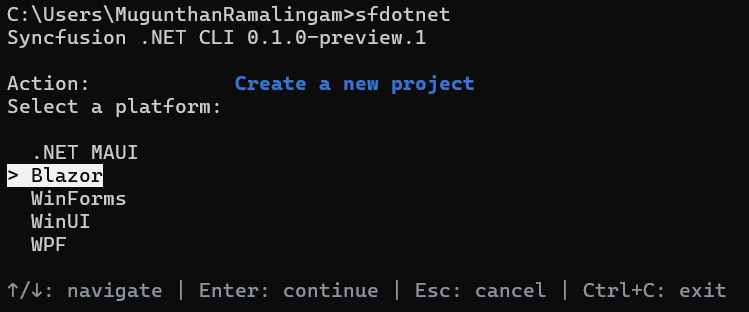
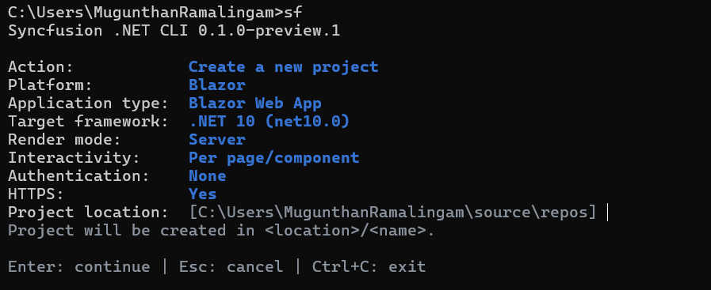
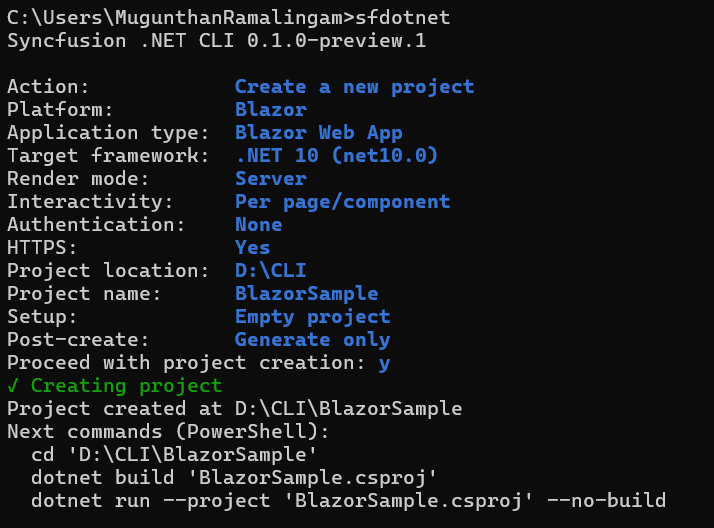

# Create a Blazor project

You can create a Blazor project through the interactive wizard or a direct command. For CLI installation and the main menu, refer to the [overview](/blazor/dotnet-cli/overview).

## Create a project using the interactive wizard

Run `sf new`, or select **Create a new project** from the main menu. The Blazor creation flow collects these inputs, in this order:

1. **Platform:** Select **Blazor**.

    

2. **Application type:** Select **Blazor Web App** or **Blazor WebAssembly App (standalone)**.
3. **Language:** C# is recorded automatically.
4. **Target framework:** Select the .NET version. Only the target frameworks reported by the installed official template are offered; .NET 10 (`net10.0`) is the default when available.
5. **Interactive render mode and interactivity** (Blazor Web App only): Select **Server**, **WebAssembly**, or **Auto** render mode, and **Per page/component** or **Global** interactivity. A standalone WebAssembly app uses WebAssembly rendering automatically and does not prompt for an interactivity location.
6. **Authentication:** Select **None** or **Individual accounts**. The official Blazor Web App Individual Accounts template is supported and requires HTTPS. Standalone WebAssembly Individual authentication requires an external identity-provider authority and client ID, so the CLI rejects that combination instead of generating placeholder credentials.
7. **HTTPS:** Select **Yes** or **No**. HTTPS is fixed to **Yes** when **Individual accounts** is chosen.
8. **Project location and name:** Enter the parent directory and the project name. The project is created in `<location>/<name>`.
9. **Setup:** Select whether to include demo pages. Demo pages are included by default.
10. **Theme:** (Demo pages only) Select one of the Syncfusion component themes described in [Themes](#themes).
11. **Components:** (Demo pages only) Choose one or more Syncfusion component demos from the following list. The picker starts with no components selected; use Space to select and Enter to continue after choosing at least one.

    | Component | Component ID |
    | --- | --- |
    | AI AssistView | `ai-assistview` |
    | Block Editor | `block-editor` |
    | Charts | `charts` |
    | Data Grid | `grid` |
    | Diagram | `diagram` |
    | Document Editor | `document-editor` |
    | File Manager | `file-manager` |
    | Gantt Chart | `gantt` |
    | Kanban | `kanban` |
    | PDF Viewer | `pdf-viewer` |
    | Pivot Table | `pivot-table` |
    | Query Builder | `query-builder` |
    | Rich Text Editor | `rich-text-editor` |
    | Scheduler | `scheduler` |
    | Spreadsheet | `spreadsheet` |

12. **Post-create:** Select **Generate only** or **Build project**.
13. **Confirmation:** Review the selected values and confirm to create the project.

N> A complete direct command does not open the wizard. When a name is missing in an interactive terminal, the wizard supplies a default and collects the remaining unspecified inputs. Missing required values in scripts produce an error.

N> For WebAssembly and Auto render modes, the CLI places the interactive demo pages, package references, imports, and service registration in the generated `.Client` project. The host project also receives `AddSyncfusionBlazor()` and the Syncfusion import so prerendering works.

N> The generated File Manager demo uses Syncfusion's public physical-file demonstration service. Replace those URLs with an application-owned, authenticated backend before production use. The PDF Viewer demo includes a small PDF as a data URI, avoiding a remote download and cross-origin restrictions. Spreadsheet creates a local budget workbook through XlsIO, and Document Editor starts with a blank editable document.

## Themes

The CLI supports the following Syncfusion component themes:

| Theme | Theme file |
| --- | --- |
| Fluent 2 | `fluent2.css` |
| Bootstrap 5.3 | `bootstrap5.3.css` |
| Bootstrap 5 | `bootstrap5.css` |
| Material 3 | `material3.css` |
| Tailwind 3 | `tailwind3.css` |

These styles theme the Syncfusion components; they do not replace the CSS framework used by Microsoft's application shell.

## Create a project using direct commands

To create a Blazor Web App with the interactive defaults (`web-app`, Server render mode, per-page interactivity, no authentication, HTTPS, Fluent 2 theme, and the Grid demo):




sf new blazor -n MyApp




To create a project with explicit options:




sf new blazor -n MyApp --render-mode server --control grid charts




To create a standalone Blazor WebAssembly app:




sf new blazor -n ClientApp --app-type webassembly-standalone --control grid




To create an official minimal project without Syncfusion packages or demos:




sf new blazor -n MyApp --control empty




Repeat `--control` or list several component IDs to generate multiple demos:




sf new blazor -n MyApp --control grid --control charts --post-action generate --no-interactive




## Run the created project

Run the generated project with the .NET CLI:




dotnet run --project ./MyApp/MyApp.csproj




N> `--post-action generate` runs the official template and writes project files without silently restoring or building. `--post-action build` restores and builds the project during creation.

## Creation options

| Option | Description |
| --- | --- |
| `-n`, `--name` | Project name. Required when prompting is unavailable |
| `-p`, `--path` | Parent directory. Defaults to the current directory |
| `-t`, `--target-framework` | The .NET target framework, such as `net10.0` |
| `--app-type` | `web-app` (default) or `webassembly-standalone` |
| `--render-mode` | `server`, `webassembly`, or `auto` (Web App only) |
| `--interactivity` | `per-page` (default) or `global` (Web App only) |
| `--auth` | `none` (default) or `individual` |
| `--https` | `yes` or `no`. Fixed to `yes` with Individual accounts |
| `--theme` | Syncfusion component theme, such as `fluent2` |
| `--control` | One or more component IDs, or `empty`. Omit to create an empty project |
| `--post-action` | Post-create action: `generate` or `build`. Defaults to `build` for direct commands |
| `--no-interactive` | Disable interactive prompts |
| `--json` | Emit a JSON document instead of table output |

## FAQs

**Which render modes are supported?**

Blazor Web App supports Server, WebAssembly, and Auto interactive render modes, with per-page/component or global interactivity. Standalone WebAssembly apps use WebAssembly rendering automatically.

**Which .NET versions are supported?**

The available target frameworks come from the installed official `blazor` and `blazorwasm` templates. .NET 10 (`net10.0`) is the default when available.

**Can I overwrite an existing project?**

No. Neither `--force` nor confirmation authorizes overwriting an existing destination. Existing destination files or directories are not overwritten or merged, and the CLI does not pick another destination automatically.

## See also

* [Manage packages in an existing project](/blazor/dotnet-cli/manage-packages)
* [License activation](/blazor/dotnet-cli/licensing)
* [Get started with Syncfusion Blazor Web App](https://blazor.syncfusion.com/documentation/getting-started/blazor-web-app)
* [Interactive render modes in Blazor](https://blazor.syncfusion.com/documentation/common/interactive-render-mode)
