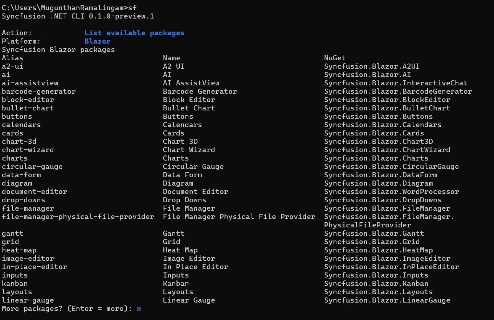

# Overview of the Syncfusion<sup>®</sup> .NET CLI

The Syncfusion<sup>®</sup> .NET CLI (`sf`) is a cross-platform command line tool that creates Blazor projects and manages Syncfusion<sup>®</sup> Blazor NuGet packages from a terminal. After you install the CLI, you can run `sf` with no arguments to open an interactive menu, or run a direct command such as `sf new blazor` for scripted, prompt-free creation.

N> The Syncfusion<sup>®</sup> .NET CLI is currently in preview and is installed with the `--prerelease` flag.

N> Package removal (`sf remove`) is temporarily disabled across all platforms while improvements are in progress.

You can use the CLI to perform the following actions:

* Create a Blazor Web App (Server, WebAssembly, or Auto render mode) or a standalone Blazor WebAssembly app, optionally containing generated Syncfusion<sup>®</sup> component demo pages.
* Add or update Syncfusion<sup>®</sup> Blazor NuGet package references in an existing project.
* List available and installed packages, and search the package catalog.
* Generate projects for Blazor, .NET MAUI, WPF, WinForms, and WinUI 3.

This documentation covers the Blazor platform.

## Prerequisites

The following software is required before you install and use the CLI:

* A [.NET SDK](https://dotnet.microsoft.com/download) that contains the ASP.NET Core Blazor templates. The CLI creates Blazor projects through the installed official `blazor` and `blazorwasm` templates; it does not carry its own copy of those templates.
* Network access to the configured NuGet sources when restore or build is selected.
* A valid Syncfusion<sup>®</sup> license registration for production applications. See the [licensing overview](https://help.syncfusion.com/common/essential-studio/licensing/overview) for details.

N> The CLI reads each installed template's help output and offers only the target frameworks the installed template reports. .NET 10 (`net10.0`) is the default when available.

N> Syncfusion<sup>®</sup> packages resolve from the official nuget.org feed, `https://api.nuget.org/v3/index.json`. Package installs resolve the latest stable release and write a concrete version, never `*`. Use `--version` to pin a release.

## Installation

The CLI is published as a .NET global tool with the package ID `Syncfusion.DotNet.CLI`.

1. Open a terminal and run the following command. Add `--prerelease` while only preview versions are available.

    ```bash
    dotnet tool install -g Syncfusion.DotNet.CLI --prerelease
    ```

2. Verify the installation and print the CLI version.

    ```bash
    sf --version
    ```

Run `sf help` for a short command map, or `sf help blazor` for the Blazor command map and package aliases.


To update the tool to the latest release, run:

```bash
dotnet tool update -g Syncfusion.DotNet.CLI --prerelease
```

To remove the tool, run:

```bash
dotnet tool uninstall -g Syncfusion.DotNet.CLI
```

## Initialize the CLI

Run `sf` in an interactive terminal to open the main menu. The menu shows the current CLI version and groups the available operations.


| Group | Operation | Command reference |
| --- | --- | --- |
| Project creation | Create a new project | `sf new` |
| Package management | Add a package to an existing project | `sf add` |
| Package management | Update a package in an existing project | `sf update` |
| Discovery | List available packages | `sf list <platform> packages` |
| Discovery | List installed packages in an existing project | `sf list <platform> installed` |
| Discovery | Search for packages | `sf search` |
| Help and information | View CLI information | `sf info` |
| Help and information | Show help | `sf help` |
| Exit | Exit | `Ctrl+C` |

N> The `<platform>` text is a usage placeholder. Use `blazor` for Blazor.

Use the following keys to navigate the interactive screens:

| Key | Action |
| --- | --- |
| Up / Down | Move through the options |
| Enter | Choose the focused option, or continue |
| Space | Toggle a checkbox in a multi-selection list |
| Escape | Cancel the current question and return to the menu |
| `Ctrl+C` | Exit the interactive session |

Complete direct commands remain usable without opening the menu. `--no-interactive` disables prompts in any command. Run `sf help blazor` to show the Blazor command map and package aliases.

## Available commands

| Command | Purpose |
| --- | --- |
| `sf new blazor` | Create a new Blazor project |
| `sf add blazor <package>` | Add a Syncfusion<sup>®</sup> package to an existing project |
| `sf update blazor <package>` | Update a package in an existing project |
| `sf list blazor packages` | List available packages in the Blazor package catalog |
| `sf list blazor installed` | List installed packages in an existing project |
| `sf search blazor <text>` | Search package aliases, IDs, names, and descriptions |
| `sf info` | Show CLI information |
| `sf help blazor` | Show the Blazor command map and package aliases |
| `sf --version` | Show the CLI version |

## Create a Blazor project

You can create a Blazor project through the interactive wizard or a direct command.

### Create a project using the interactive wizard

Run `sf new`, or select **Create a new project** from the main menu. The Blazor creation flow collects these inputs, in this order:

1. **Platform:** Select **Blazor**.

    

2. **Application type:** Select **Blazor Web App** or **Blazor WebAssembly App (standalone)**.
3. **Language:** C# is recorded automatically.
4. **Target framework:** Select the .NET version. Only the target frameworks reported by the installed official template are offered; .NET 10 (`net10.0`) is the default when available.
5. **Interactive render mode and interactivity** (Blazor Web App only): Select **Server**, **WebAssembly**, or **Auto** render mode, and **Per page/component** or **Global** interactivity. A standalone WebAssembly app uses WebAssembly rendering automatically and does not prompt for an interactivity location.
6. **Authentication:** Select **None** or **Individual accounts**. The official Blazor Web App Individual Accounts template is supported and requires HTTPS. Standalone WebAssembly Individual authentication requires an external identity-provider authority and client ID, so the CLI rejects that combination instead of generating placeholder credentials.
7. **HTTPS:** Select **Yes** or **No**. HTTPS is fixed to **Yes** when **Individual accounts** is chosen.
8. **Project location and name:** Enter the parent directory and the project name. The project is created in `<location>/<name>`.
9. **Setup:** Select whether to include demo pages. Demo pages are included by default.
10. **Theme:** (Demo pages only) Select one of the Syncfusion component themes described in [Themes](#themes).
11. **Components:** (Demo pages only) Choose one or more Syncfusion component demos from the list. The picker starts with no components selected; use Space to select and Enter to continue after choosing at least one.
12. **Post-create:** Select **Generate only** or **Build project**.
13. **Confirmation:** Review the selected values and confirm to create the project.

N> A complete direct command does not open the wizard. When a name is missing in an interactive terminal, the wizard supplies a default and collects the remaining unspecified inputs. Missing required values in scripts produce an error.

13. Review the configured values and confirm to create the project.

    

N> For WebAssembly and Auto render modes, the CLI places the interactive demo pages, package references, imports, and service registration in the generated `.Client` project. The host project also receives `AddSyncfusionBlazor()` and the Syncfusion import so prerendering works.

N> Demo pages are generated as `<Component>Demo.razor` so they never collide with component type names. Creation is transactional until generation completes; failures roll back the newly created directory.

### Available components

The following component demos can be generated in a new Blazor project:

| Component | Component ID |
| --- | --- |
| AI AssistView | `ai-assistview` |
| Block Editor | `block-editor` |
| Charts | `charts` |
| Diagram | `diagram` |
| Document Editor | `document-editor` |
| File Manager | `file-manager` |
| Gantt Chart | `gantt` |
| Kanban | `kanban` |
| PDF Viewer | `pdf-viewer` |
| Pivot Table | `pivot-table` |
| Query Builder | `query-builder` |
| Scheduler | `scheduler` |
| Spreadsheet | `spreadsheet` |
| Data Grid | `grid` |
| Rich Text Editor | `rich-text-editor` |

N> The generated File Manager demo uses Syncfusion's public physical-file demonstration service. Replace those URLs with an application-owned, authenticated backend before production use. The PDF Viewer demo includes a small PDF as a data URI, avoiding a remote download and cross-origin restrictions. Spreadsheet creates a local budget workbook through XlsIO, and Document Editor starts with a blank editable document.

### Themes

The CLI supports the following Syncfusion component themes:

| Theme | Theme file |
| --- | --- |
| Fluent 2 | `fluent2.css` |
| Bootstrap 5.3 | `bootstrap5.3.css` |
| Bootstrap 5 | `bootstrap5.css` |
| Material 3 | `material3.css` |
| Tailwind 3 | `tailwind3.css` |

These styles theme the Syncfusion components; they do not replace the CSS framework used by Microsoft's application shell.

### Create a project using direct commands

To create a Blazor Web App with the interactive defaults (`web-app`, Server render mode, per-page interactivity, no authentication, HTTPS, Fluent 2 theme, and the Grid demo):

```bash
sf new blazor -n MyApp
```

To create a project with explicit options:

```bash
sf new blazor -n MyApp --render-mode server --control grid charts
```

To create a standalone Blazor WebAssembly app:

```bash
sf new blazor -n ClientApp --app-type webassembly-standalone --control grid
```

To create an official minimal project without Syncfusion packages or demos:

```bash
sf new blazor -n MyApp --control empty
```

Repeat `--control` or list several control IDs to generate multiple demos:

```bash
sf new blazor -n MyApp --control grid --control charts --post-action generate --no-interactive
```

## Run the created project

Run the generated project with the .NET CLI:

```bash
dotnet run --project ./MyApp/MyApp.csproj
```

N> `--post-action generate` runs the official template and writes project files without silently restoring or building. `--post-action build` restores and builds the project during creation.


## Manage packages in an existing project

Package operations change NuGet references only. They do not generate control files.

`<package>` accepts a canonical package alias, a canonical package ID, or an exact unambiguous package display name:

```bash
sf add blazor grid --path ./MyApp
sf update blazor grid --path ./MyApp
```

Existing-project commands accept `-p/--path` with a project file, a project directory, or a supported subdirectory. Without it, the current directory is used. A directory with one Blazor project is selected automatically; when multiple projects are present, interactive mode presents a selector and non-interactive mode requires an explicit project path. `--json` emits one JSON document for script use.

To list available packages, list installed packages, and search the catalog:

```bash
sf list blazor packages
sf list blazor installed --path ./MyApp
sf search grid --framework blazor
```

Use `--details` on the list command for package descriptions, release status, registration requirements, documentation links, and whether a generated sample is available.



## Options reference

### Creation options

| Option | Description |
| --- | --- |
| `-n`, `--name` | Project name. Required when prompting is unavailable |
| `-p`, `--path` | Parent directory. Defaults to the current directory |
| `-t`, `--target-framework` | The .NET target framework, such as `net10.0` |
| `--app-type` | `web-app` (default) or `webassembly-standalone` |
| `--render-mode` | `server`, `webassembly`, or `auto` (Web App only) |
| `--interactivity` | `per-page` (default) or `global` (Web App only) |
| `--auth` | `none` (default) or `individual` |
| `--https` | `yes` or `no`. Fixed to `yes` with Individual accounts |
| `--theme` | Syncfusion component theme, such as `fluent2` |
| `--control` | One or more component IDs, or `empty`. Omit to create an empty project |
| `--post-action` | Post-create action: `generate` or `build`. Defaults to `build` for direct commands |
| `--no-interactive` | Disable interactive prompts |
| `--json` | Emit a JSON document instead of table output |

### Package operation options

| Option | Description |
| --- | --- |
| `-p`, `--path` | The project directory, `.csproj` file, or a supported subdirectory |
| `-v`, `--version` | The Syncfusion<sup>®</sup> NuGet package version |
| `--source` | Package source; Syncfusion<sup>®</sup> packages require `https://api.nuget.org/v3/index.json` |
| `--configfile` | The NuGet configuration file to use |
| `--dry-run` | Preview the action without making changes |
| `--force` | Allow supported overwrites |
| `--no-restore` | Skip `dotnet restore` after the action |
| `--json` | Emit one JSON document |

### Global options

| Option | Description |
| --- | --- |
| `-h`, `--help` | Show command help |
| `--version` | Show the CLI version |
| `--interactive` | Allow prompts when running in an interactive terminal |
| `--no-interactive` | Disable prompts |
| `--json` | Emit machine-readable output |
| `--verbose` | Write diagnostics to stderr |
| `--no-color` | Disable colored output |

## FAQs

**Does the CLI generate a license key?** No. Syncfusion<sup>®</sup> licensing requirements continue to apply. Refer to the [licensing overview](https://help.syncfusion.com/common/essential-studio/licensing/overview) to generate and register a license key in your project.

**Does `sf add blazor grid` generate the Grid demo?** No. Package operations change NuGet references only; they do not generate control files. Use `sf new blazor --control grid` during creation, or generate demos from the creation wizard.

**Which render modes are supported?** Blazor Web App supports Server, WebAssembly, and Auto interactive render modes, with per-page/component or global interactivity. Standalone WebAssembly apps use WebAssembly rendering automatically.

**Which .NET versions are supported?** The available target frameworks come from the installed official `blazor` and `blazorwasm` templates. .NET 10 (`net10.0`) is the default when available.

**Can I overwrite an existing project?** No. Neither `--force` nor confirmation authorizes overwriting an existing destination. Existing destination files or directories are not overwritten or merged, and the CLI does not pick another destination automatically.

**Which platforms does the CLI support?** Blazor, .NET MAUI, WPF, WinForms, and WinUI 3. This documentation covers Blazor.

## See also

* [Syncfusion Blazor components](https://www.syncfusion.com/blazor-components)
* [Get started with Syncfusion Blazor Web App](https://blazor.syncfusion.com/documentation/getting-started/blazor-web-app)
* [Install Syncfusion Blazor NuGet packages](https://blazor.syncfusion.com/documentation/installation/install-nuget-packages)
* [Interactive render modes in Blazor](https://blazor.syncfusion.com/documentation/common/interactive-render-mode)