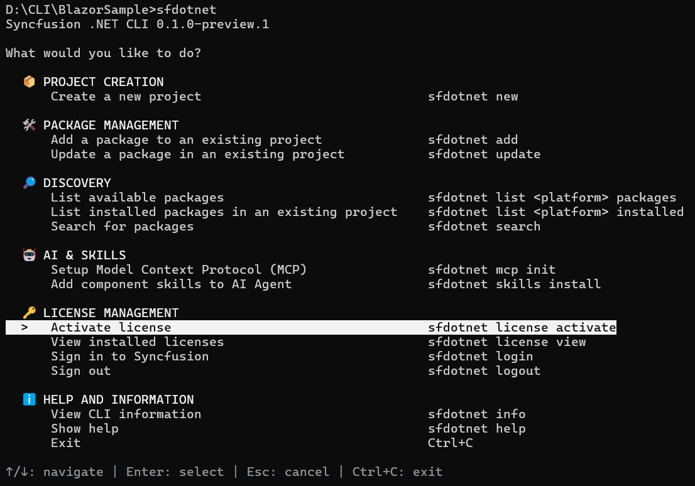
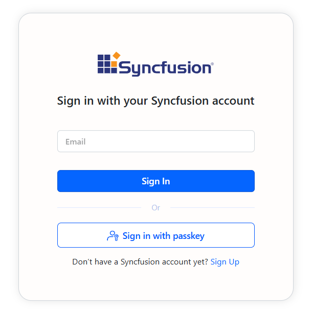
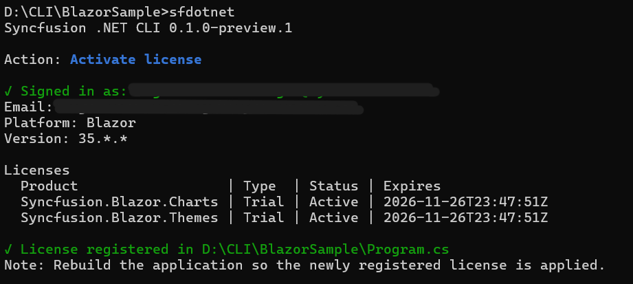
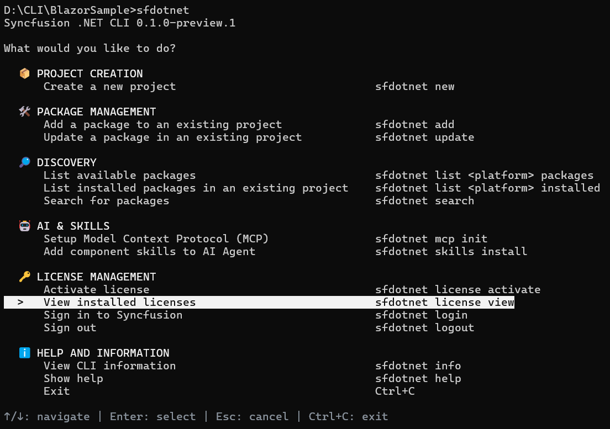
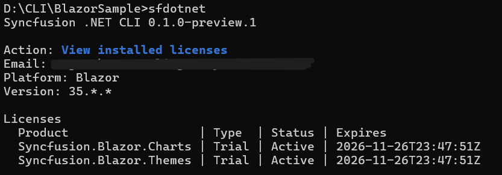

# Activate Syncfusion® licenses

The CLI detects the Syncfusion® controls used in a project, downloads the matching license keys from your Syncfusion® account, and registers the keys in the project's startup code. For example, when a sample is created with the Chart component, the CLI registers the license for `Syncfusion.Blazor.Charts` in `Program.cs` so the build runs without a license warning.

N> Open the Command Prompt or Terminal in the target sample's project directory before running the license activation command. The license operation is project-specific, and the command path must point to the intended sample.

## Sign in requirements

License activation requires a signed-in Syncfusion® account with an entitlement that covers the packages used in the project:

* A Syncfusion® account with a paid license, a free trial, or a free community license. Refer to the [licensing overview](https://help.syncfusion.com/common/essential-studio/licensing/overview) for details.
* Sign in is performed through the browser. When a license command needs an authenticated session, the CLI opens the default browser on the Syncfusion® sign-in page, and completes sign in with your Syncfusion® account credentials.
* When every control in the project is covered by a paid entitlement, the matching keys are downloaded without further prompts.
* When a control in the project is not covered by a paid entitlement, the CLI prompts you to accept the Syncfusion® trial EULA and download a trial key for the missing packages.

N> When a license key is supplied through `--file`, the CLI skips sign in and download and registers the keys already in the file. The file path must be absolute.

## Sign in and sign out

The CLI stores a local sign-in session so repeated license operations do not require a new browser sign in each time.

To sign in without running an activation, run:




sfdotnet login




The CLI opens the default browser on the Syncfusion® sign-in page. Complete sign in with your Syncfusion® account, and the CLI stores the session locally.

To sign out and clear the local session, run:




sfdotnet logout




N> Signing out does not affect the licenses already registered in a project. The cached license keys and the `SyncfusionLicenseProvider.RegisterLicense(...)` call remain in place until you change or remove them.

## Activate a license through the interactive menu

1. Open the Command Prompt or Terminal in the target sample's project directory.

    
    

    cd ./BlazorSample

    
    

2. Run `sfdotnet` to open the main menu.

    
    

    sfdotnet

    
    

3. Under **License management**, select **Activate license**. The CLI focuses the **Activate License** entry and shows the navigation hint at the bottom of the screen.

    

4. If you are not signed in, the CLI opens your default browser to the Syncfusion® sign-in page. Complete sign in with your Syncfusion® account.

    

5. After sign in, the CLI checks your entitlements, downloads the matching keys for the Syncfusion® controls in the sample, and registers the keys in `Program.cs`.

    

6. Rebuild the application so the newly registered license is applied. The CLI prints the following reminder at the end of the activation output.

    > Note: Rebuild the application so the newly registered license is applied.

## Activate a license using a direct command

Run the activation command from the sample's project directory:




sfdotnet license activate




Pass `--path` to point the CLI at a specific project directory or `.csproj` file:




sfdotnet license activate --path ./MyApp
sfdotnet license activate --path ./MyApp/MyApp.csproj




Use `--yes` to accept the trial EULA prompt without asking:




sfdotnet license activate --yes




Use `--file` to activate from an existing key file. With no value, the CLI reads `./syncfusion-license.txt` from the project directory. With an absolute path, the CLI uses the specified file instead:




sfdotnet license activate --file
sfdotnet license activate --file "C:\Keys\syncfusion-license.txt"




## View installed licenses

To see the licenses cached for the current project, run:




sfdotnet license view




The command reads the cached metadata, lists each product, the license type, the status, and the expiry date, and warns when a Syncfusion® package in the project is not covered.

The cached output reports the registered email, platform, major version, and one row per product.

## License options

| Option | Description |
| --- | --- |
| `-p`, `--path` | The project directory or `.csproj`/`.vbproj` to scan for Syncfusion® packages. Defaults to the current directory |
| `-y`, `--yes` | Accept the trial EULA prompt automatically during activation |
| `--file` | Activate from an existing key file. With no value, the CLI reads `./syncfusion-license.txt` from the project directory. With an absolute path, the CLI uses the specified file |
| `--json` | Emit one JSON document instead of table output |

## FAQs

**Does the CLI register a license?**

Yes. `sfdotnet license activate` scans the project for Syncfusion® packages, downloads the matching license keys from your Syncfusion® account, and registers them in `Program.cs`. The CLI signs you in through the browser the first time, or you can sign in ahead with `sfdotnet login`. For background information on Syncfusion® licensing, refer to the [licensing overview](https://help.syncfusion.com/common/essential-studio/licensing/overview).

**Can I use my own key file?**

Yes. Run `sfdotnet license activate --file "C:\Keys\syncfusion-license.txt"` with an absolute path. The CLI reads the keys from the file and registers them in the project's startup code without contacting the license service.

## See also

* [Create a Blazor project](/blazor/dotnet-cli/create-project)
* [Manage packages in an existing project](/blazor/dotnet-cli/manage-packages)
* [Syncfusion® licensing overview](https://help.syncfusion.com/common/essential-studio/licensing/overview)
