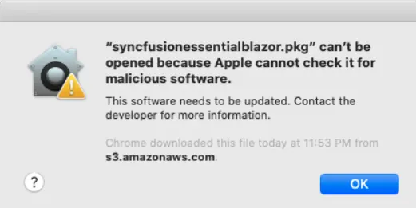
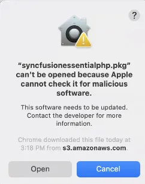
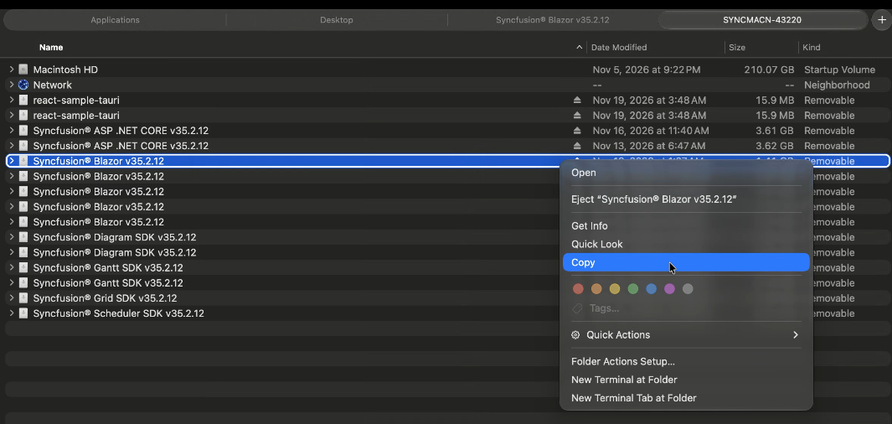

# Install the Syncfusion® Blazor Mac installer

The Essential Studio&reg; Blazor Mac installer installs the Blazor product on macOS (DMG) and integrates with Visual Studio Code. The steps below cover Gatekeeper prompts, installation, and license key registration for sample projects.

## Prerequisites

Before installing, verify the following:

* A supported version of macOS is installed. See the [.NET supported OS list](https://learn.microsoft.com/en-us/dotnet/core/install/macos) for details.
* Install the [.NET SDK](https://dotnet.microsoft.com/en-us/download) version required by your Syncfusion Blazor release version. Verify the installed version by running `dotnet --version`.
* You have administrator rights on the Mac to install applications and modify security settings.
* The downloaded Blazor Mac installer DMG is available locally. If you have not downloaded it yet, see [Download the Blazor Mac installer](https://blazor.syncfusion.com/documentation/installation/mac-installer/how-to-download).
* To open the included sample projects in Visual Studio Code, install [Visual Studio Code](https://code.visualstudio.com/download). You can also build and run them with the .NET CLI.

## Resolve the macOS Gatekeeper prompt

macOS Gatekeeper may display a security warning when you open the downloaded DMG. This behavior can vary by macOS version and security settings.

If this appears, follow these steps:

1. Right-click the downloaded `.dmg` file.
2. Select **Open** and choose **DiskImageMounter (Default)**. The following prompt appears.
   
   

3. Select **Open** to mount the DMG and continue.

## Install on macOS

1. Locate the downloaded DMG file and double-click it to open.

   

2. The disk image mounts, and a virtual drive appears on the desktop or in the Finder sidebar.

   

3. In Finder, right-click the mounted **Syncfusion® Blazor [version]** volume and select **Copy**.

   

   N> An unlock key is not required to install the Essential Studio® Blazor Mac installer.

4. Open the **Applications** folder and paste the copied item.

5. In **Applications**, open **Syncfusion® Blazor [version]** > **Syncfusion** > **[version]** > **Blazor**. Open **Samples** to access the included sample projects.

   
   
6. When you are finished, eject the mounted DMG by right-clicking its volume in Finder or on the desktop and selecting **Eject**. Move the downloaded DMG to the Trash if you no longer need it.

## Register the license key in sample projects

Register a Syncfusion license key in each sample application before initializing Syncfusion components. For project-specific instructions, see [Register a Syncfusion license key in a Blazor application](https://blazor.syncfusion.com/documentation/getting-started/license-key/how-to-register-in-an-application).

N> License keys are validated offline during application execution and do not require an internet connection at runtime.

Place the license key according to the project type:

| Blazor project type | Project to update | File |
|---|---|---|
| Blazor Web App, Interactive Server | Server project | `Program.cs` |
| Blazor Web App, Interactive WebAssembly | Server and client projects | `Server/Program.cs` and `Client/Program.cs` |
| Blazor Web App, Interactive Auto | Server and client projects | `Server/Program.cs` and `Client/Program.cs` |
| Standalone Blazor WebAssembly app | Client project | `Program.cs` |

For the complete registration steps, see [Register a Syncfusion license key in a Blazor application](https://blazor.syncfusion.com/documentation/getting-started/license-key/how-to-register-in-an-application).

N> License keys are validated offline during application execution and do not require an internet connection at runtime.

## Getting Started

- [Getting Started with a Blazor Server App](https://blazor.syncfusion.com/documentation/getting-started/blazor-server-side-visual-studio?tabcontent=visual-studio-code)
- [Getting Started with a Blazor Web App](https://blazor.syncfusion.com/documentation/getting-started/blazor-web-app?tabcontent=visual-studio-code)
- [Getting Started with a standalone Blazor WebAssembly App](https://blazor.syncfusion.com/documentation/getting-started/blazor-webassembly-app?tabcontent=visual-studio-code)
