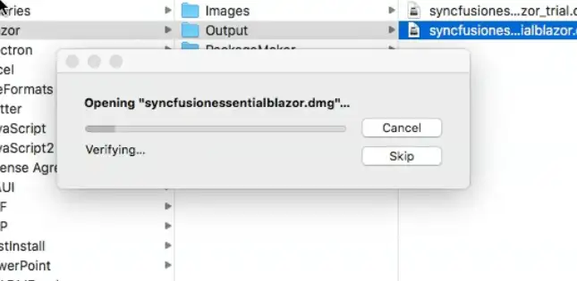
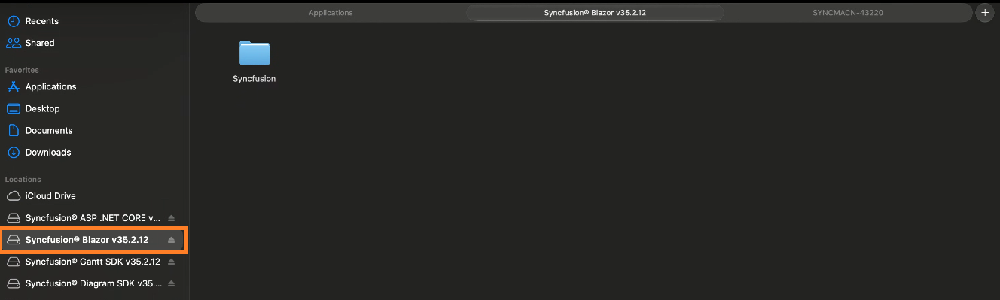

# Install the Syncfusion® Blazor Mac installer

The Essential Studio&reg; Blazor Mac installer installs the Blazor product on macOS (DMG) and integrates with Visual Studio for Mac. The steps below cover Gatekeeper prompts, installation, and license key registration for sample projects.

## Prerequisites

Before installing, verify the following:

* A supported version of macOS is installed. See the [.NET supported OS list](https://learn.microsoft.com/en-us/dotnet/core/install/macos) for details.
* The [.NET SDK](https://dotnet.microsoft.com/en-us/download) required by the target Syncfusion Blazor package version. Verify the installation by running `dotnet --version`.
* You have administrator rights on the Mac to install applications and modify security settings.
* The downloaded Blazor Mac installer DMG is available locally. If you have not downloaded it yet, see [Download the Blazor Mac installer](https://blazor.syncfusion.com/documentation/installation/mac-installer/how-to-download).
* If you intend to open and run the included sample projects, ensure that one of the supported development environments is installed:
  - [Visual Studio 2026](https://visualstudio.microsoft.com/downloads/#visual-studio-professional-2026)
  - [Visual Studio 2022](https://visualstudio.microsoft.com/vs/older-downloads/#visual-studio-2022-and-other-products)
  - [Visual Studio Code](https://code.visualstudio.com/download)

N> Do not use [Visual Studio for Mac](https://learn.microsoft.com/en-us/previous-versions/visualstudio/mac/installation?view=vsmac-2022) as a prerequisite or setup option. Visual Studio for Mac was retired, and Visual Studio Code or the .NET CLI is recommended for macOS development.

## Resolve the macOS Gatekeeper prompt

macOS Gatekeeper may display a security warning when you open the downloaded DMG. This behavior can vary by macOS version and security settings.

If this appears, follow these steps:

1. Right-click the downloaded `.dmg` file.
2. Select **Open** and choose **DiskImageMounter (Default)**. The following prompt appears.
   
   

3. Select **Open** to mount the DMG and continue.

> macOS will not allow the installer to run unless the downloaded file passes the system's signing and security checks. If the warning continues, review the macOS privacy and security settings before opening the file.

## Install on macOS

1. Locate the downloaded DMG file and double-click it to open.

   

2. The disk image is mounts and a virtual drive appears on the desktop or in the Finder sidebar.

   

3. Copy the installer file from the mounted disk image.

   

   N> An unlock key is not required to install the Essential Studio® Blazor Mac installer.

4. Paste the copied file into the **Applications** folder.

5. Open **Applications** folder and launch the installer app.

   

6. Complete the installer prompts and wait for the installation to finish.
7. Verify that the installer application and included demo source are available in the installed location.

After installation, eject the mounted DMG by right-clicking the virtual drive in Finder or on the desktop and selecting **Eject**. Move the downloaded DMG to the Trash only if you no longer need it.

## Register the license key in sample projects

After installation, a license key is required to register the demo source included in the Mac installer. The license key is applied in the entry point of your Blazor application.

Place the license key according to the project type:

| Blazor project type | Project to update | File |
|---|---|---|
| Blazor Web App, Interactive Server | Server project | `Program.cs` |
| Blazor Web App, Interactive WebAssembly | Server and client projects | `Server/Program.cs` and `Client/Program.cs` |
| Blazor Web App, Interactive Auto | Server and client projects | `Server/Program.cs` and `Client/Program.cs` |
| Standalone Blazor WebAssembly app | Client project | `Program.cs` |

For the complete registration steps, see [Register a Syncfusion license key in a Blazor application](https://blazor.syncfusion.com/documentation/getting-started/license-key/how-to-register-in-an-application).

N> License keys are validated offline during application execution and do not require an internet connection at runtime.

## Getting Started

- [Getting Started with a Blazor Server App](https://blazor.syncfusion.com/documentation/getting-started/blazor-server-side-visual-studio)
- [Getting Started with a Blazor Web App](https://blazor.syncfusion.com/documentation/getting-started/blazor-web-app)
- [Getting Started with a standalone Blazor WebAssembly App](https://blazor.syncfusion.com/documentation/getting-started/blazor-webassembly-app)
