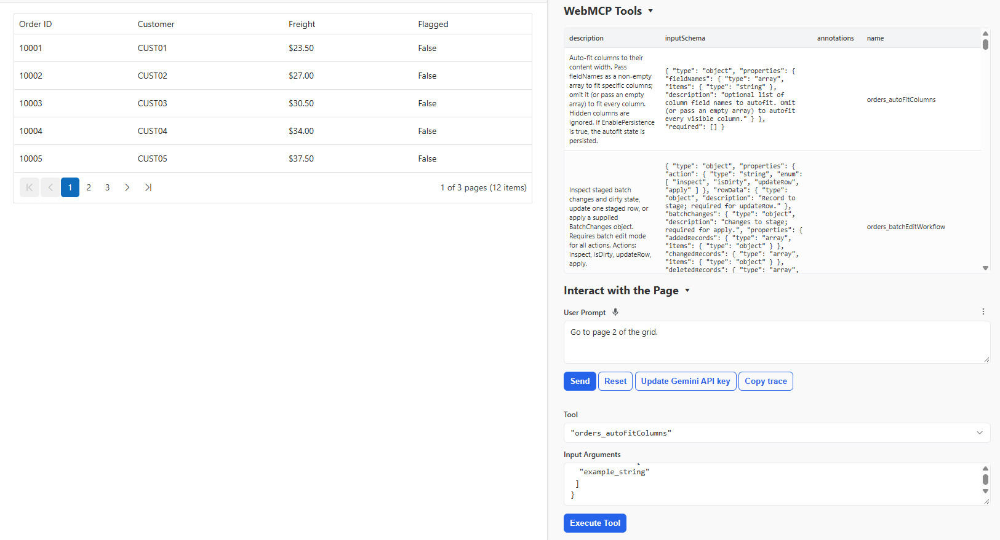
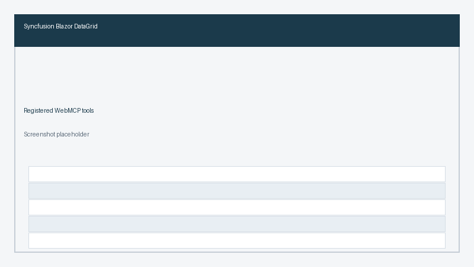
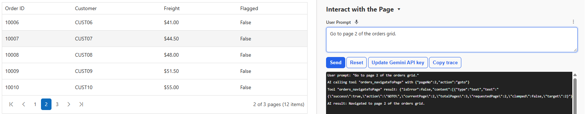

# Getting Started with WebMCP

Enable WebMCP on a component with one property, then confirm its tools are registered in the browser. This example uses the Data Grid. The other components follow the same pattern.

## Prerequisites

Before you begin, ensure you have:

* A Blazor app with the Syncfusion&reg; component already rendering. Use an interactive render mode. Static SSR does not run the browser registration. See [interactive render mode](../common/interactive-render-mode).
* A Chromium-based browser with the WebMCP origin trial or `chrome://flags/#enable-webmcp` enabled. The API is experimental, so confirm it in the browser versions you support. You also need an agent or extension that can call WebMCP tools.

## Enable WebMCP

Set `EnableWebMcp` to `true`. Optionally set `Name` on the component's `WebMcpSettings` tag so tool names stay unique on the page.




@page "/orders"
@rendermode InteractiveServer
@using Syncfusion.Blazor.Grids

<SfGrid DataSource="@Orders" EnableWebMcp="true" AllowPaging="true">
    <GridWebMcpSettings Name="orders" />
    <GridPageSettings PageSize="5"></GridPageSettings>
    <GridColumns>
        <GridColumn Field="@nameof(Order.OrderID)" HeaderText="Order ID" IsPrimaryKey="true" Width="110"></GridColumn>
        <GridColumn Field="@nameof(Order.CustomerID)" HeaderText="Customer" Width="140"></GridColumn>
        <GridColumn Field="@nameof(Order.Freight)" HeaderText="Freight" Format="C2" Width="120"></GridColumn>
        <GridColumn Field="@nameof(Order.Flagged)" HeaderText="Flagged" Width="110"></GridColumn>
    </GridColumns>
</SfGrid>

@code {
    public class Order
    {
        public int OrderID { get; set; }
        public string CustomerID { get; set; } = string.Empty;
        public double Freight { get; set; }
        public bool Flagged { get; set; }
    }

    private List<Order> Orders = Enumerable.Range(1, 12).Select(i => new Order
    {
        OrderID = 10000 + i,
        CustomerID = $"CUST{i:00}",
        Freight = 20 + i * 3.5,
        Flagged = false
    }).ToList();
}




`EnableWebMcp` turns registration on. `Name` becomes the prefix for the tool names. If you omit it, the component `ID` is used, then a generated ID.

## Verify the tools

Call `GetWebMcpToolsAsync` to list the tools the component registered.




@page "/orders"
@rendermode InteractiveServer
@using Syncfusion.Blazor.Grids

<button class="e-btn" @onclick="ShowToolsAsync">List WebMCP tools</button>

<ul>
    @foreach (var line in ToolLines)
    {
        <li>@line</li>
    }
</ul>

<SfGrid @ref="grid" DataSource="@Orders" EnableWebMcp="true" AllowPaging="true">
    <GridWebMcpSettings Name="orders" />
    <GridPageSettings PageSize="5"></GridPageSettings>
    <GridColumns>
        <GridColumn Field="@nameof(Order.OrderID)" HeaderText="Order ID" IsPrimaryKey="true" Width="110"></GridColumn>
        <GridColumn Field="@nameof(Order.CustomerID)" HeaderText="Customer" Width="140"></GridColumn>
        <GridColumn Field="@nameof(Order.Freight)" HeaderText="Freight" Format="C2" Width="120"></GridColumn>
        <GridColumn Field="@nameof(Order.Flagged)" HeaderText="Flagged" Width="110"></GridColumn>
    </GridColumns>
</SfGrid>

@code {
    public class Order
    {
        public int OrderID { get; set; }
        public string CustomerID { get; set; } = string.Empty;
        public double Freight { get; set; }
        public bool Flagged { get; set; }
    }

    private SfGrid<Order> grid = default!;
    private List<string> ToolLines = new();

    private List<Order> Orders = Enumerable.Range(1, 12).Select(i => new Order
    {
        OrderID = 10000 + i,
        CustomerID = $"CUST{i:00}",
        Freight = 20 + i * 3.5,
        Flagged = false
    }).ToList();

    private async Task ShowToolsAsync()
    {
        var tools = await grid.GetWebMcpToolsAsync();
        ToolLines = tools.Select(t => $"{t.Name}: {t.Description}").ToList();
    }
}




Pass a list of names to `GetWebMcpToolsAsync` to inspect specific tools only.

## Try a first prompt

With your agent connected, ask for something the component can do, for example "Go to page 2 of the orders grid." The agent picks the matching tool, the component runs it, and the grid changes on screen.

## See also

* [WebMCP overview](./overview) explains how a component registers tools and how an agent calls them.
* [Configure WebMCP tools](./tools) shows how to enable, disable, rename, and add tools after registration works.
* [Security and best practices](./security) covers what to check before you enable tools that change data.
* [Supported components](./components) lists the built-in tools you can call from an agent prompt.
* [WebMCP FAQ](./faq) covers missing tools, name collisions, and confirmation timing.
* Explore the [Data Grid feature tour](https://www.syncfusion.com/blazor-components/blazor-datagrid) for the component used in this sample.
