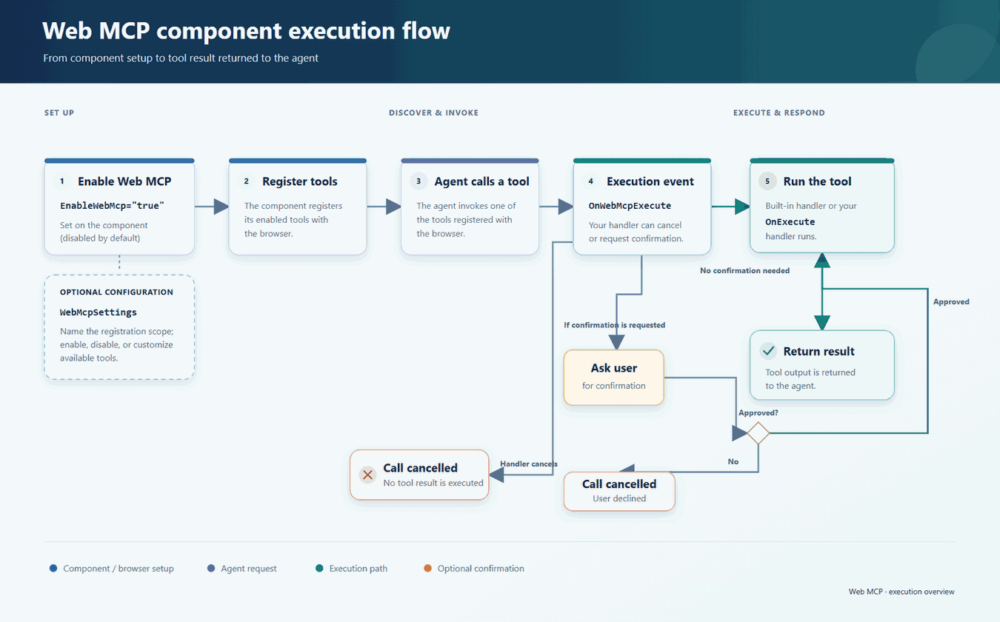

# WebMCP for Blazor Components

WebMCP lets a browser-based AI agent operate a Syncfusion&reg; Blazor component through named tools that the component registers with the browser. It is built on the experimental `document.modelContext.registerTool` API and currently works only in Chromium-based browsers.

## What is WebMCP?

When WebMCP is enabled, a component publishes a set of tools such as "go to page", "update cell", or "insert text". Each tool has a name, a description, and an input schema. An agent running in the browser discovers these tools and calls them with arguments. The component runs the matching action and returns a result.

## Why use it?

* **No backend integration.** Tools are registered in the page itself, so you do not host an MCP server or build an API layer for the component.
* **Works on live UI state.** The agent acts on the same grid, document, or spreadsheet the user is looking at, including selection and unsaved edits.
* **You stay in control.** You choose which tools are exposed, rename or replace them, add custom tools, and gate each call with the `OnWebMcpExecute` event.

## How it works

1. Set `EnableWebMcp` to `true` on the component. It is `false` by default.
2. Optionally add a `WebMcpSettings` child tag to name the registration scope and to enable, disable, or customize tools.
3. The component registers its enabled tools with the browser.
4. When an agent calls a tool, the component raises `OnWebMcpExecute`. This is the only handler. Cancel the call, or set `ShowConfirmationDialog` for a built-in tool. A custom tool does not get that dialog. Handle a custom tool in this event and set `Result`. See [Confirm a custom tool](./tools#confirm-a-custom-tool).
5. For a built-in tool, the component handler runs and returns the result. For a custom tool, the agent receives the `Result` you set. `WebMcpTool` does not have an `OnExecute` callback.

N> WebMCP registration runs in the browser. Use an interactive render mode. Static server-side rendering does not register tools.

## How it compares

| Approach | Where it runs | Best for |
| --- | --- | --- |
| WebMCP | In the user's browser, on the live component | Letting an in-browser agent operate the UI the user already has open |
| MCP server | On a server or local process, outside the page | Giving agents access to data, files, and services without a UI |
| AI-powered components | Inside the component, as built-in AI features | Features you ship to users directly, such as assistive panels |
| A2UI | Agent-generated interface description rendered by the host | Letting an agent compose new UI rather than drive existing UI |

WebMCP is separate from the [Syncfusion Blazor MCP Server](https://blazor.syncfusion.com/documentation/mcp). The MCP Server supplies documentation and code generation to an IDE. WebMCP exposes the running component to an agent in the browser.

## Supported components

WebMCP is available for the Data Grid, Scheduler, Chart, Gantt, Diagram, File Manager, Rich Text Editor, PDF Viewer, Document Editor, and Spreadsheet. Tool lists for each component are in the [Components](./components) topic.

## Terms used in this guide

| Term | Meaning |
| --- | --- |
| Tool | A named action with a description and input schema that an agent can call |
| Built-in tool | A tool shipped with the component, selected with a `Command` value |
| Custom tool | A tool you define with `Command="Custom"`, your own name, schema, and handler |
| Prefix | The `Name` of the WebMCP settings, used to keep tool names unique per component instance |

## See also

* [Quick start](./getting-started)
* [Tools](./tools)
* [Security and best practices](./security)
* [Components](./components)
* [FAQ](./faq)
