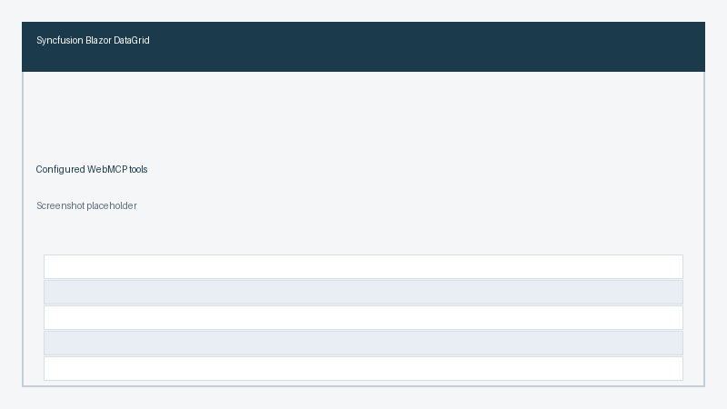
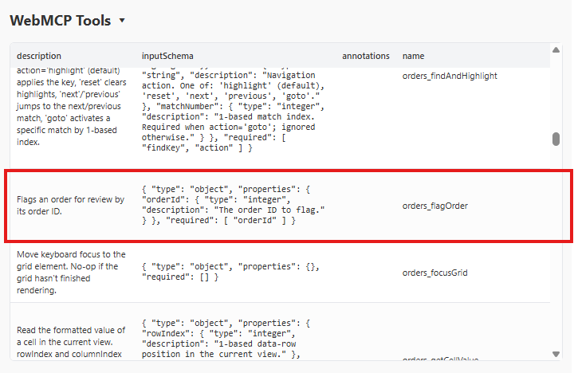
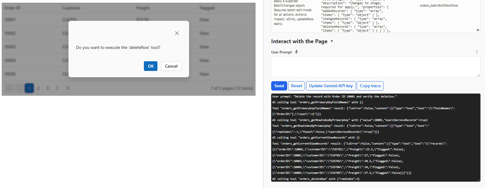

# Configure WebMCP Tools in Blazor Components

Each component ships built-in tools. You can enable, disable, or rename them, add custom tools, and handle every call in one component event. Tools are declared inside `WebMcpSettings` > `WebMcpTools` > `WebMcpTool` child tags. The tags are prefixed with the component name, for example `GridWebMcpTool`.

There is no `OnExecute` callback on `WebMcpTool`. Custom work, cancellation, confirmation, and the result all belong in `OnWebMcpExecute`.

## Configure tools

A built-in tool is selected with `Command`. The properties below apply to every tool entry.

| Property | Purpose | Default |
| --- | --- | --- |
| `Command` | Built-in command to configure, or `Custom` for your own tool | `None` |
| `Name` | Registered tool name. Required for custom tools. Optional override for built-in tools | Generated |
| `Description` | Text the agent reads to decide when to call the tool | Built-in text |
| `InputSchema` | JSON schema for the tool's arguments. Required for custom tools | Built-in schema |
| `Enabled` | Whether the tool is registered with the browser | `true` |

Tools that return document or data content are disabled by default, so you opt in deliberately. Examples are PDF Viewer `GetBookmarks`, `GetAnnotations`, `GetFormFields`, `GetSearchTextPositions`, and `GetPageText`, and Spreadsheet `GetRangeData`.




@page "/orders"
@rendermode InteractiveServer
@using System.Text.Json
@using Syncfusion.Blazor.Grids

<SfGrid @ref="grid" DataSource="@Orders" EnableWebMcp="true" AllowPaging="true">
    <GridEvents TValue="Order" OnWebMcpExecute="OnToolExecuting" />
    <GridWebMcpSettings Name="orders">
        <GridWebMcpTools>
            <GridWebMcpTool Command="GridWebMcpToolCommand.ExcelExport" Enabled="false" />
            <GridWebMcpTool Command="GridWebMcpToolCommand.Custom"
                            Name="getSelectedOrders"
                            Description="Returns the orders selected in the grid."
                            InputSchema="@SelectedSchema"
                            Enabled="true" />
        </GridWebMcpTools>
    </GridWebMcpSettings>
    <GridPageSettings PageSize="5"></GridPageSettings>
    <GridColumns>
        <GridColumn Field="@nameof(Order.OrderID)" HeaderText="Order ID" IsPrimaryKey="true" Width="110"></GridColumn>
        <GridColumn Field="@nameof(Order.CustomerID)" HeaderText="Customer" Width="140"></GridColumn>
        <GridColumn Field="@nameof(Order.Freight)" HeaderText="Freight" Format="C2" Width="120"></GridColumn>
        <GridColumn Field="@nameof(Order.Flagged)" HeaderText="Flagged" Width="110"></GridColumn>
    </GridColumns>
</SfGrid>

@code {
    public class Order
    {
        public int OrderID { get; set; }
        public string CustomerID { get; set; } = string.Empty;
        public double Freight { get; set; }
        public bool Flagged { get; set; }
    }

    private SfGrid<Order> grid = default!;

    private const string SelectedSchema = """{ "type": "object", "properties": {} }""";

    private List<Order> Orders = Enumerable.Range(1, 12).Select(i => new Order
    {
        OrderID = 10000 + i,
        CustomerID = $"CUST{i:00}",
        Freight = 20 + i * 3.5,
        Flagged = false
    }).ToList();

    private async Task OnToolExecuting(GridWebMcpExecuteEventArgs args)
    {
        if (!args.Name.EndsWith("getSelectedOrders"))
        {
            return;
        }

        var selected = await grid.GetSelectedRecordsAsync();
        args.Result = JsonSerializer.Serialize(selected);
    }
}




## Custom tools

Set `Command` to `Custom` to expose an action the component does not provide. A custom tool needs a `Name`, a `Description`, and an `InputSchema`. Handle the call in `OnWebMcpExecute`, match `args.Name`, and set `args.Result`.




@page "/orders"
@rendermode InteractiveServer
@using Syncfusion.Blazor.Grids

<SfGrid DataSource="@Orders" EnableWebMcp="true" AllowPaging="true">
    <GridEvents TValue="Order" OnWebMcpExecute="OnToolExecuting" />
    <GridWebMcpSettings Name="orders">
        <GridWebMcpTools>
            <GridWebMcpTool Command="GridWebMcpToolCommand.Custom"
                            Name="flagOrder"
                            Description="Flags an order for review by its order ID."
                            InputSchema="@FlagSchema" />
        </GridWebMcpTools>
    </GridWebMcpSettings>
    <GridPageSettings PageSize="5"></GridPageSettings>
    <GridColumns>
        <GridColumn Field="@nameof(Order.OrderID)" HeaderText="Order ID" IsPrimaryKey="true" Width="110"></GridColumn>
        <GridColumn Field="@nameof(Order.CustomerID)" HeaderText="Customer" Width="140"></GridColumn>
        <GridColumn Field="@nameof(Order.Freight)" HeaderText="Freight" Format="C2" Width="120"></GridColumn>
        <GridColumn Field="@nameof(Order.Flagged)" HeaderText="Flagged" Width="110"></GridColumn>
    </GridColumns>
</SfGrid>

@code {
    public class Order
    {
        public int OrderID { get; set; }
        public string CustomerID { get; set; } = string.Empty;
        public double Freight { get; set; }
        public bool Flagged { get; set; }
    }

    private const string FlagSchema = """
        { "type": "object",
          "properties": { "orderId": { "type": "integer", "description": "The order ID to flag." } },
          "required": ["orderId"] }
        """;

    private List<Order> Orders = Enumerable.Range(1, 12).Select(i => new Order
    {
        OrderID = 10000 + i,
        CustomerID = $"CUST{i:00}",
        Freight = 20 + i * 3.5,
        Flagged = false
    }).ToList();

    private void OnToolExecuting(GridWebMcpExecuteEventArgs args)
    {
        if (!args.Name.EndsWith("flagOrder"))
        {
            return;
        }

        var orderId = int.Parse(args.Arguments["orderId"]?.ToString() ?? "0");
        var order = Orders.FirstOrDefault(o => o.OrderID == orderId);
        if (order is null)
        {
            args.Result = "Order not found.";
            return;
        }

        order.Flagged = true;
        args.Result = "Order flagged.";
    }
}




## Control tool execution

Every call raises `OnWebMcpExecute`. This is the only handler. The event arguments expose `Name`, `Arguments`, `ShowConfirmationDialog`, `Cancel`, and, on some components, `Result`.

The order of work for each call is:

1. The component resolves the tool.
2. `OnWebMcpExecute` runs.
3. If `Cancel` is `true`, execution stops and a cancellation response is returned.
4. If `ShowConfirmationDialog` is `true`, the component asks the user to confirm a built-in tool. Custom tools do not get that dialog.
5. For a built-in tool, the component handler runs and returns the result. For a custom tool, the result is the value you set on `Result` in this event.

N> `ShowConfirmationDialog` is applied by the component for built-in tools only. It does not show a dialog for a custom tool. Ask inside `OnWebMcpExecute`, and set `Result` only after the user accepts. See [Confirm a custom tool](#confirm-a-custom-tool), [Security and best practices](./security), and the [FAQ](./faq).

For a built-in write tool, set `ShowConfirmationDialog` and leave the work to the component. Do not change data in the event for that call. The component runs its handler only after the user accepts.




@page "/orders"
@rendermode InteractiveServer
@using Syncfusion.Blazor.Grids

<SfGrid DataSource="@Orders" EnableWebMcp="true" AllowPaging="true">
    <GridEvents TValue="Order" OnWebMcpExecute="OnToolExecuting" />
    <GridWebMcpSettings Name="orders" />
    <GridPageSettings PageSize="5"></GridPageSettings>
    <GridColumns>
        <GridColumn Field="@nameof(Order.OrderID)" HeaderText="Order ID" IsPrimaryKey="true" Width="110"></GridColumn>
        <GridColumn Field="@nameof(Order.CustomerID)" HeaderText="Customer" Width="140"></GridColumn>
        <GridColumn Field="@nameof(Order.Freight)" HeaderText="Freight" Format="C2" Width="120"></GridColumn>
    </GridColumns>
</SfGrid>

@code {
    public class Order
    {
        public int OrderID { get; set; }
        public string CustomerID { get; set; } = string.Empty;
        public double Freight { get; set; }
    }

    private bool UserCanEditOrders { get; set; } = true;

    private List<Order> Orders = Enumerable.Range(1, 12).Select(i => new Order
    {
        OrderID = 10000 + i,
        CustomerID = $"CUST{i:00}",
        Freight = 20 + i * 3.5
    }).ToList();

    private void OnToolExecuting(GridWebMcpExecuteEventArgs args)
    {
        if (args.Name.EndsWith("SetCellValue") && !UserCanEditOrders)
        {
            args.Cancel = true;
            return;
        }

        if (args.Name.EndsWith("SetCellValue"))
        {
            args.ShowConfirmationDialog = true;
        }
    }
}




## Confirm a custom tool

A custom tool ignores `ShowConfirmationDialog`. Ask in `OnWebMcpExecute`, and set `Result` only when the user accepts. This sample uses `window.confirm` through `IJSRuntime`. Replace that call with a Syncfusion dialog if the page already uses one.




@page "/orders"
@rendermode InteractiveServer
@inject IJSRuntime JS
@using Syncfusion.Blazor.Grids

<SfGrid DataSource="@Orders" EnableWebMcp="true" AllowPaging="true">
    <GridEvents TValue="Order" OnWebMcpExecute="OnToolExecuting" />
    <GridWebMcpSettings Name="orders">
        <GridWebMcpTools>
            <GridWebMcpTool Command="GridWebMcpToolCommand.Custom"
                            Name="flagOrder"
                            Description="Flags an order for review by its order ID."
                            InputSchema="@FlagSchema" />
        </GridWebMcpTools>
    </GridWebMcpSettings>
    <GridPageSettings PageSize="5"></GridPageSettings>
    <GridColumns>
        <GridColumn Field="@nameof(Order.OrderID)" HeaderText="Order ID" IsPrimaryKey="true" Width="110"></GridColumn>
        <GridColumn Field="@nameof(Order.CustomerID)" HeaderText="Customer" Width="140"></GridColumn>
        <GridColumn Field="@nameof(Order.Freight)" HeaderText="Freight" Format="C2" Width="120"></GridColumn>
        <GridColumn Field="@nameof(Order.Flagged)" HeaderText="Flagged" Width="110"></GridColumn>
    </GridColumns>
</SfGrid>

@code {
    public class Order
    {
        public int OrderID { get; set; }
        public string CustomerID { get; set; } = string.Empty;
        public double Freight { get; set; }
        public bool Flagged { get; set; }
    }

    private const string FlagSchema = """
        { "type": "object",
          "properties": { "orderId": { "type": "integer", "description": "The order ID to flag." } },
          "required": ["orderId"] }
        """;

    private List<Order> Orders = Enumerable.Range(1, 12).Select(i => new Order
    {
        OrderID = 10000 + i,
        CustomerID = $"CUST{i:00}",
        Freight = 20 + i * 3.5,
        Flagged = false
    }).ToList();

    private async Task OnToolExecuting(GridWebMcpExecuteEventArgs args)
    {
        if (!args.Name.EndsWith("flagOrder"))
        {
            return;
        }

        var orderId = int.Parse(args.Arguments["orderId"]?.ToString() ?? "0");
        var order = Orders.FirstOrDefault(o => o.OrderID == orderId);
        if (order is null)
        {
            args.Result = "Order not found.";
            return;
        }

        var accepted = await JS.InvokeAsync<bool>("confirm", $"Flag order {orderId}?");
        if (!accepted)
        {
            args.Cancel = true;
            return;
        }

        order.Flagged = true;
        args.Result = "Order flagged.";
    }
}




## Inspect tools

`GetWebMcpToolsAsync(IEnumerable<string>? toolNames = null)` returns the registered tools as `IWebMcpTool` items with `Name`, `Description`, and `InputSchema`. Use it to confirm which tools an agent can see.

## See also

* [Security and best practices](./security)
* [Supported components](./components)
* API reference for the `WebMcpTool` and `WebMcpExecuteEventArgs` classes of each component
